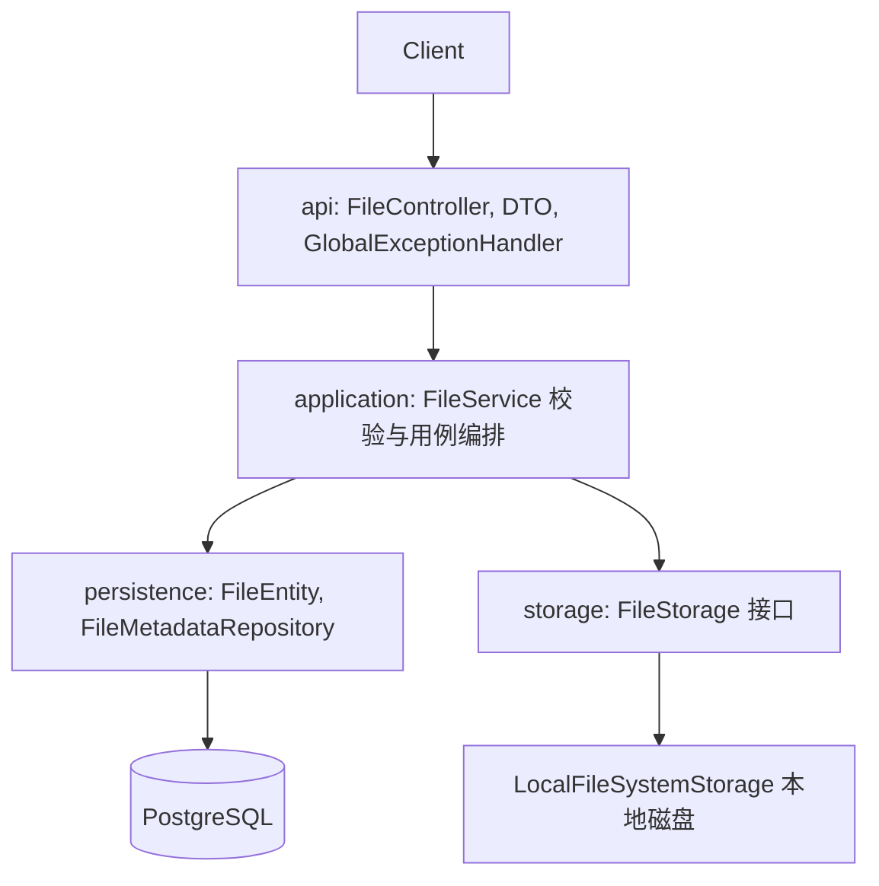
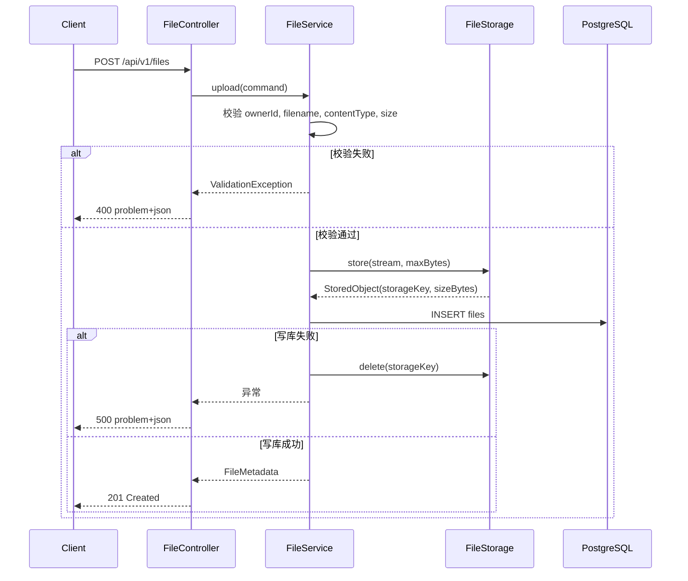

# 企业云盘（Enterprise Drive）架构设计文档

| 项 | 内容 |
|---|---|
| 状态 | 第 3 版，已合入两轮评审意见。尚未写任何代码，尚未安装任何软件 |
| 日期 | 2026-11-22 |
| 范围 | 技术选型覆盖 L1–L3；详细设计只覆盖 L1；L2/L3 只给方向 |

第 3 版相对第 2 版的改动：

- 项目只做原生运行，去掉了 `Dockerfile` 和 `docker-compose.yml`（3.13、第 7 章）。
- content type 允许清单扩充到 14 种（5.5）。
- 写明覆盖率的官方统计方式和检查命令（6.2）。
- 新增依赖清单，逐个说明用途（3.14）。
- `.gitignore` 里的 `*.jar` 已删除（3.6）。

第 2 版相对第 1 版的改动：

- Spring Boot 改为最新的 4.2.0（3.4）。
- content type 改为可配置的允许清单（5.5、5.8）。
- 新增单元测试覆盖率 80% 门槛和 ArchUnit 分层检查（第 6 章）。
- 重写第 7 章：环境安装清单和本地运行方案（其中的容器运行方式已在第 3 版去掉）。
- 新增列表不分页对 L2、L3 的影响（8.3）。

## 1. 背景与范围

### 1.1 背景

企业云盘后端练习题，技术栈限定 Java + Spring Boot。需求分 Level 1–3，每一级在前一级的代码基础上继续做。每一级都要经过验收确认后才开始下一级。

### 1.2 本文档的范围

- **技术选型**按 L1–L3 的全部需求来选，避免 L1 选的东西在 L2/L3 被推翻。
- **详细设计**只写 L1。
- **L2/L3** 只在第 8 章写演进方向和留待决定的问题，等 L1、L2 分别验收后再细化。

### 1.3 需求来源

| 代号 | 文件 | 说明 |
|---|---|---|
| R | `requirement.txt` | 原始书面需求，含各级 Acceptance Criteria（AC）和 Functional Requirement（FR） |
| T | `transcription.txt` | 需求讲解会议的录音转写 |
| O | `requirement-organizedbydeepseek.md` | 对 R 和 T 的整理稿 |

我把 O 和 R、T 对照读过，L1 部分内容一致。

### 1.4 R 和 T 之间的一处口径差异

- R 只写了**列表**限定在 owner 范围内，按 ID 检索没有提 owner。
- T 里讲解人说“所有的retriever，然后list都应该是scope在当前用户下的”（T 12:03 的需求讲解，转写原文）。

本设计按更严格的 T 口径：按 ID 检索也限定 owner，访问别人的文件返回 404。已确认（A2）。

### 1.5 L1 明确不做的事

以下内容 L1 需求没有要求，本设计不包含：

- 文件下载、删除、重命名
- 真实的登录认证和权限模型
- 列表分页
- 幂等上传、内容校验和（L2）
- 分片上传、预览、限流（L3）

## 2. 需求追溯表

L1 的每条 AC 和 FR 对应到本文档的设计章节。

| 编号 | 需求（R 原文摘要） | 设计章节 |
|---|---|---|
| AC-1 Upload | 上传返回 201，含 file ID、storage key、timestamp；文件经 storage layer 存储，不进数据库表 | 5.2、5.3、5.4、5.7 |
| AC-2 Retrieval | metadata 可检索且准确；列表限定 owner，newest first | 5.1、5.2、5.3 |
| AC-3 Validation | owner、name、type、size 无效时返回 machine-readable error，且不创建文件 | 5.4、5.5、5.6 |
| AC-4 HTTP contract | 400 invalid、404 unknown、201 success，无 stack trace | 5.2、5.6 |
| FR-1 Upload | 提供上传 endpoint 并创建 metadata 记录 | 5.2、5.4 |
| FR-2 fileId | 服务端生成 fileId，成功返回前持久化 metadata | 5.3、5.4 |
| FR-3 Storage abstraction | 文件字节经存储抽象保存，不进关系表 | 3.9、4、5.7 |
| FR-4 Retrieval | 按 ID 检索 metadata | 5.2 |
| FR-5 Listing | 列出 owner 的文件，newest first，限定该 owner | 5.2、5.3 |
| FR-6 Validation | 校验 ownerId、filename、content type、size；拒绝空文件和超限文件 | 5.5 |
| FR-7 HTTP contract | 成功 201 带已持久化的 metadata；无效 400；未知文件 404 | 5.2、5.6 |
| FR-8 Layering | API、application/service、persistence、storage 职责分离 | 4、6.3 |

## 3. 技术选型与理由

### 3.1 环境约束

选型受以下事实约束：

- 开发机是 Windows，2026-11-22 检查时**没有** JDK、Maven、Docker、PostgreSQL。
- **项目只做原生运行，不使用 Docker**（B3）。另一台机器装了严格的安全套件，装 Docker 会被要求卸载。
- 数据库原生安装。
- 单元测试的行覆盖率必须达到 80% 以上。
- 题目没有付费的后端服务可用，存储位置由开发者决定（T 16:48–17:31）。

### 3.2 选型总览

| 领域 | 选择 | 版本 | 核实情况 |
|---|---|---|---|
| 语言与运行时 | Java（Eclipse Temurin） | 21 | winget 上有 `EclipseAdoptium.Temurin.21.JDK` 21.0.13 |
| 框架 | Spring Boot | 4.2.0 | Maven Central 上的最新正式版，也是 start.spring.io 的默认值 |
| Web | Spring MVC，同步处理 | 随 Boot | 4.2.0 下的坐标已核实：`spring-boot-starter-webmvc` |
| 构建 | Maven + Maven Wrapper | 随 wrapper | `.gitignore` 已不再忽略 jar，wrapper 带不带 jar 都能提交 |
| 数据库 | PostgreSQL | 17 | winget 上有 `PostgreSQL.PostgreSQL.17` 17.12 |
| 数据访问 | Spring Data JPA | 随 Boot | 4.2.0 下的坐标已核实：`spring-boot-starter-data-jpa` |
| 表结构迁移 | Flyway | 随 Boot（flyway-core 12.11.0） | 已核实：`spring-boot-starter-flyway` 4.2.0 不带 PostgreSQL 支持模块，要显式加 `org.flywaydb:flyway-database-postgresql` |
| 文件存储 | 自定义 `FileStorage` 接口 + 本地文件系统实现 | 无 | 自研，无外部依赖 |
| 错误格式 | RFC 9457 Problem Details | 随 Spring | 使用 Spring 自带的 `ProblemDetail` |
| 校验 | 应用层显式规则 + Bean Validation（校验配置项） | 随 Boot | 4.2.0 下的坐标已核实：`spring-boot-starter-validation` |
| 单元测试 | JUnit Jupiter、Mockito、MockMvc | 随 Boot（JUnit Jupiter 6.1.3、Mockito 5.24.0） | 已核实 `spring-boot-starter-webmvc-test` 4.2.0 的 POM |
| 覆盖率 | JaCoCo Maven 插件 | 0.8.16 | Maven Central 上的最新版；与本工程的配合**未验证** |
| 分层检查 | ArchUnit（核心库 `archunit`） | 1.5.1 | Maven Central 上的最新版；与本工程的配合**未验证** |
| 集成测试数据库 | zonky embedded-postgres | 2.2.3 | Maven Central 上有该版本和 Windows amd64 的 17.12.0 二进制包；能否在本机实际启动**未验证** |
| 部署 | 原生运行，可执行 jar | 无 | 不使用 Docker |

标“未核实”“未验证”的条目汇总在 9.3，都要在 L1 实现的第一步验证。每个依赖在项目里具体做什么见 3.14。

### 3.3 Java 21

**理由**

- 题目限定 Java。21 是成熟的 LTS，评审机器上最可能已有或最容易装上。
- start.spring.io 提供的 Java 选项是 17、21、25、27，21 在其中。
- `record`、`switch` 模式匹配等语法足够让 DTO 和校验代码写得简短。

**备选**

- Java 25：更新的 LTS。没有选它是因为本题用不到它的新特性，而 21 的工具链兼容面更广。我没有查 winget 上是否有 Temurin 25 的包。
- Java 17：可用，但没有理由选更旧的版本。

### 3.4 Spring Boot 4.2.0

按评审意见（A7）使用最新版本。

**理由**

- 4.2.0 是 Maven Central 上当前最新的正式版（元数据最后更新于 2026-11-19），也是 start.spring.io 的默认选项。
- 本设计用到的 starter 坐标在 4.2.0 下都已核实（见 3.2）。

**代价**

- 4.2.0 是 4.2 线的第一个版本，按上面的日期看刚发布不久。第三方库（zonky embedded-postgres、ArchUnit、JaCoCo）和它能否配合，我没有查，要在实现的第一步实测。
- 退路：如果遇到绕不过去的兼容问题，改回 4.1.3 只需要改 `pom.xml` 里的一个版本号，本文其余设计不变。发生这种情况我会先告诉你，不会自行降级。

**没有做的事**：我没有查各版本线的官方支持周期。

### 3.5 Spring MVC，同步上传

**理由**

- FR-2 要求“成功返回前持久化 metadata”，同步处理正好是这个语义：请求线程写完文件、写完数据库，再返回 201。
- L1 单次上传上限 100 MB（见 5.5），不需要异步化。
- 阻塞模型的代码最容易读，也最容易测试。
- 讲解人明确说同步异步都可以（T 15:36–15:40）。

**备选**

- WebFlux：响应式模型对这道题没有收益，而且和 JPA 的阻塞访问不匹配。
- 异步上传（先返回 202，再后台处理）：和“返回 201 且 metadata 已持久化”的 AC 冲突。

### 3.6 Maven + Maven Wrapper

**理由**

- 评审人只需要有 JDK，执行 `mvnw` 就能构建，不用装 Maven。
- Maven 的 `pom.xml` 是声明式的，评审时比 Gradle 脚本更容易一眼看清依赖。

**一个细节**：仓库原来的 `.gitignore` 忽略了 `*.jar`，会让 wrapper 的 `maven-wrapper.jar` 提交不上去。按评审意见，这一行已经从 `.gitignore` 里删掉。相应地，L1 生成工程骨架时要把 Maven 的构建输出目录 `target/` 加进 `.gitignore`，否则构建出来的 jar 会被当成待提交的文件。

**备选**

- Gradle：同样可行，没有选它只是因为上面的可读性考虑。

### 3.7 PostgreSQL 17

**理由**

按三个等级的需求看，一个数据库能覆盖所有持久化状态：

- **L1**：metadata 表、按 owner 和时间倒序的索引。
- **L2**：幂等要求“并发重复请求保持正确”，靠 `(owner_id, idempotency_key)` 唯一约束在数据库层面保证，比应用内加锁可靠，而且多实例下依然成立。
- **L3**：预览任务要求“同一 job 不被两个 worker 领取”，PostgreSQL 的 `SELECT ... FOR UPDATE SKIP LOCKED` 是实现这类任务队列的常用手段，不需要再引入消息队列。
- **L3**：多实例部署时，所有实例连同一个数据库，会话、任务、幂等记录天然共享。

原生安装的数据库（winget 17.12）和集成测试用的数据库（zonky 二进制包 17.12.0）是同一个版本。

**备选**

- H2 文件数据库：零安装，L1 起步最快。没有选它是因为 SQL 方言和锁行为与 PostgreSQL 不同，L3 一定要迁移，L2 的并发正确性测试也会建立在和最终数据库不同的行为上。
- MySQL：同样支持 `SKIP LOCKED`，可行。选 PostgreSQL 是因为有不依赖 Docker 的嵌入式测试方案（见 3.12）。
- PostgreSQL 18：winget 和 zonky 上都有 18.7，同样可行。选 17 是因为它发布更久，而本设计用不到 18 才有的功能。

### 3.8 Spring Data JPA + Flyway

**理由**

- JPA 让 L1 的增查代码很少：一个实体、一个 repository 接口。
- 表结构由 Flyway 的 SQL 脚本显式管理并纳入版本控制；Hibernate 设为 `ddl-auto=validate`，只校验实体和表是否一致，不自动改表。这样每一级新增的表和列都有一份可评审的迁移脚本。
- L3 用到的 `SKIP LOCKED` 可以用原生 SQL 查询写，不受 JPA 限制。

**备选**

- Spring Data JDBC 或 JdbcTemplate：更直接，没有持久化上下文的隐式行为。对这道题也可行；选 JPA 是因为它是 Spring Boot 项目里评审人最熟悉的方式。
- Hibernate 自动建表（`ddl-auto=update`）：表结构变化不可评审、不可回溯，不采用。
- Liquibase：功能等价，Flyway 的纯 SQL 脚本更简单。

### 3.9 存储抽象 + 本地文件系统

**理由**

- AC-1 和 FR-3 要求文件字节经过存储抽象保存，不进数据库表。设计一个 `FileStorage` 接口，业务代码只依赖接口。
- L1 的实现写本地磁盘。没有付费云服务可用，本地实现零依赖、可离线运行、测试时指向临时目录即可。
- 写入方式是先写临时文件、再原子移动到最终位置，读的一方不会看到写了一半的文件。

**L1 的接口只有两个方法**：存入、删除。L1 没有下载需求，所以不提前加读取方法，等到有需求的那一级再加。

**备选**

- 直接上 MinIO 或 S3：MinIO 要另行安装和启动，L1 用不上它的任何能力。
- 文件存数据库 `bytea` 列：被 AC-1 明确禁止。

L3 是继续用本地实现还是增加 S3 兼容实现，留到 L3 决定（见 8.2）。

### 3.10 错误格式：RFC 9457 Problem Details

**理由**

- AC-3 要求错误是 machine-readable 的。RFC 9457 是 HTTP API 错误体的标准格式，Spring 自带 `ProblemDetail` 类型支持，不用自己发明结构。
- 在标准字段之外加两个扩展字段：稳定的 `code`（给程序判断用）和字段级的 `errors` 列表。
- 全局异常处理器兜底所有未预期异常，返回不含内部信息的 500；同时关闭 Spring Boot 默认错误页的 stack trace 输出。

**备选**

- 自定义 `{code, message}` 结构：也能满足需求，但没有理由不用标准。

### 3.11 校验

- 业务校验规则（ownerId、filename、content type、size）写在 application 层，是显式的 Java 代码。原因是 L1 的输入来自请求头和 multipart 分段，不是 JSON 请求体，注解式校验在这里用不上多少；规则放在 application 层也使它不依赖 HTTP，可以直接做单元测试。
- 允许上传的 content type 是一份可配置的清单（A4），规则见 5.5。
- Bean Validation 用来在启动时校验配置项（例如大小上限必须为正、允许清单不能为空）。
- 文件大小以实际收到和写入的字节数为准，不信任请求头里的 `Content-Length`。

### 3.12 测试工具

测试分两类，分工见第 6 章。

- **单元测试**：JUnit Jupiter + Mockito + MockMvc（standalone 模式，不启动 Spring 上下文）。不需要数据库，只装了 JDK 就能跑。80% 的覆盖率门槛只按这一类测试计算。
- **覆盖率：JaCoCo**。Java 项目里最通用的覆盖率工具，能在构建里设门槛，不达标就让构建失败。统计方式和命令见 6.2。
- **分层检查：ArchUnit**（A8）。把 4.3 的依赖规则写成测试，违反分层时构建失败。只用它的核心库，规则写成普通的测试方法。不用它的 `archunit-junit5` 集成模块，是因为 Boot 4.2.0 带的是 JUnit Jupiter 6.1.3，我没有核实那个模块能否配合；核心库不依赖 JUnit 的版本。
- **集成测试用真实的 PostgreSQL**，不用 H2 替身，这样测到的 SQL 行为和生产一致。
  - 首选 **zonky embedded-postgres**：它把真实的 PostgreSQL 二进制包作为 Maven 依赖下载并在测试进程里启动，不需要 Docker。直接用它的核心库启动数据库，再把连接信息交给 Spring，不使用它的 Spring 集成模块，以减少和 Boot 4.2 的耦合。
  - **未验证**：它在这台 Windows 机器、Java 21 上能否实际启动。另外，它会把 PostgreSQL 程序解压到临时目录再执行，装了安全套件的那台机器有可能拦截这种行为。
  - **退路**：集成测试改连本机原生安装的 PostgreSQL 上的一个独立测试库。

**备选**

- Testcontainers：业界最常用，但它需要 Docker，本项目不使用 Docker。

### 3.13 部署：原生运行

按评审意见（B3），项目只做原生运行，不使用 Docker。

- 应用打成一个可执行 jar，用 `java -jar` 启动；开发时用 `mvnw spring-boot:run`。命令见 7.2。
- 应用依赖的外部服务只有一个：原生安装的 PostgreSQL。
- 仓库里不提供 `Dockerfile` 和 `docker-compose.yml`。
- L3 要求的“documented deployment command”届时就是这条 `java -jar` 命令加上需要的环境变量。

### 3.14 依赖清单与用途

下面是 L1 要引入的全部依赖。L2、L3 要新增依赖时，会在对应等级的设计里用同样的方式列出。

**运行时依赖**

| 依赖 | 版本 | 在本项目里具体做什么 |
|---|---|---|
| `spring-boot-starter-parent`（父 POM） | 4.2.0 | 统一管理下面各个 Spring 依赖和 Maven 插件的版本，所以大多数依赖不用自己写版本号 |
| `spring-boot-starter-webmvc` | 随 Boot | 带入内嵌 Tomcat、Spring MVC 和 Jackson。用于：对外的三个 HTTP 接口（5.2）；解析 multipart 上传；请求和响应的 JSON 转换；`ProblemDetail` 错误体和全局异常处理（5.6） |
| `spring-boot-starter-data-jpa` | 随 Boot | 带入 Hibernate、Spring Data JPA 和 JDBC 支持。用于：`FileEntity` 与 `files` 表的映射；`FileMetadataRepository` 的插入、按 ID 查询、按 owner 倒序查询（5.3）；写 metadata 时的数据库事务（5.4）；数据库连接池 |
| `spring-boot-starter-flyway` | 随 Boot（flyway-core 12.11.0） | 应用启动时自动执行 SQL 迁移脚本，建出 `files` 表和索引（5.3）。以后每一级的表结构变更也通过它执行 |
| `org.flywaydb:flyway-database-postgresql` | 与 flyway-core 一致 | Flyway 的 PostgreSQL 支持模块。Boot 的 Flyway starter 只带核心库，不带它；没有它 Flyway 不能对 PostgreSQL 执行迁移 |
| `org.postgresql:postgresql` | 随 Boot | PostgreSQL 的 JDBC 驱动，应用通过它连接数据库 |
| `spring-boot-starter-validation` | 随 Boot | 应用启动时校验配置项（5.8），例如大小上限必须为正、允许清单不能为空；配置写错时启动就失败。上传字段的业务校验不用它，是手写的规则（3.11） |

**测试依赖**（只在测试时使用，不打进最终的 jar）

| 依赖 | 版本 | 在本项目里具体做什么 |
|---|---|---|
| `spring-boot-starter-webmvc-test` | 随 Boot | 一次带入下面这些测试库 |
| ↳ JUnit Jupiter | 6.1.3 | 编写和运行全部测试 |
| ↳ Mockito | 5.24.0 | 单元测试里制造替身：测 `FileService` 时替换 repository 和存储，测 `FileController` 时替换 `FileService`（6.1） |
| ↳ AssertJ、JSONPath | 3.27.7、3.0.0 | 写断言；JSONPath 用来检查响应 JSON 里的字段 |
| ↳ MockMvc | 随 Spring | 不启动真实服务器就能向 controller 发请求，用来测状态码、响应头、响应体和错误格式 |
| ↳ Spring Boot 测试支持 | 随 Boot | 集成测试里启动完整的应用上下文 |
| `com.tngtech.archunit:archunit` | 1.5.1 | 读取编译后的类，检查包之间的依赖方向是否符合 4.3 的分层规则（6.3） |
| `io.zonky.test:embedded-postgres` | 2.2.3 | 集成测试开始时在本机临时启动一个真实的 PostgreSQL 进程，测试结束后关闭并清理。这样集成测试不依赖你手工安装的那个数据库，也不会改动它的数据 |
| `io.zonky.test.postgres:embedded-postgres-binaries-bom` | 17.12.0 | 指定 zonky 启动的 PostgreSQL 版本为 17.12，和原生安装的版本一致 |

**构建插件**（只在构建时使用）

| 插件 | 版本 | 在本项目里具体做什么 |
|---|---|---|
| Maven Wrapper（`mvnw.cmd`） | 随生成的工程 | 第一次执行时自动下载指定版本的 Maven，所以不用单独安装 Maven |
| `spring-boot-maven-plugin` | 随 Boot | `spring-boot:run` 启动应用；把应用打成可执行 jar |
| `maven-surefire-plugin` | 随 Boot | 运行单元测试（`*Test`） |
| `maven-failsafe-plugin` | 随 Boot | 运行集成测试（`*IT`）；`-DskipITs` 可以跳过它们 |
| `org.jacoco:jacoco-maven-plugin` | 0.8.16 | 统计单元测试的行覆盖率、生成报告、检查 80% 门槛（6.2） |

表里的版本号中，4.2.0、12.11.0、6.1.3、5.24.0、3.27.7、3.0.0 是我从 Maven Central 上 Boot 4.2.0 的 POM 里读到的；1.5.1、2.2.3、17.12.0、0.8.16 是我在 Maven Central 上查到的现有版本。“带入 Hibernate”“带入连接池”这类传递依赖的说法是 starter 的常规内容，我没有逐个展开核对，工程生成后以 `mvnw dependency:tree` 的输出为准。

### 3.15 明确不引入的东西

| 不引入 | 原因 |
|---|---|
| Docker、Testcontainers | 项目只做原生运行（B3） |
| Spring Security | L1 没有认证需求，owner 用请求头模拟（见 5.1） |
| Lombok、MapStruct | 用 `record` 就够，少一层注解处理器 |
| Redis、消息队列 | L1 用不到；L2/L3 是否需要到时再定 |
| Actuator、OpenAPI/Swagger | 需求没有要求 |
| 内容类型嗅探（如 Tika） | L1 只拿客户端声明的类型对照允许清单（见 5.5） |

## 4. 总体架构与分层

### 4.1 结构

单个 Spring Boot 应用，单个 Maven 模块，按职责分四个包。



```text
com.enterprisedrive
├── api            FileController、FileResponse、FileListResponse、GlobalExceptionHandler
├── application    FileService、FileMetadata、UploadCommand、业务异常
├── persistence    FileEntity、FileMetadataRepository
└── storage        FileStorage、StoredObject、LocalFileSystemStorage
```

包名 `com.enterprisedrive` 是暂定的，可以改。

### 4.2 各层职责

| 层 | 负责 | 不负责 |
|---|---|---|
| api | HTTP 路由、从请求里取出参数、把结果和异常转成 HTTP 响应 | 业务规则、访问数据库或磁盘 |
| application | 校验规则、上传用例的步骤编排、失败时的补偿 | HTTP 细节、SQL、文件路径 |
| persistence | metadata 的存取、排序查询 | 文件字节、业务规则 |
| storage | 文件字节的写入和删除、存储键的生成 | metadata、谁拥有这个文件 |

### 4.3 依赖规则

- 依赖只能自上而下：`api → application → persistence / storage`。
- `api` 不直接接触 `persistence` 和 `storage`。
- `persistence` 和 `storage` 互不依赖，也不依赖上层。
- JPA 实体 `FileEntity` 不离开 application 层：`FileService` 返回 `FileMetadata`（一个 `record`），`api` 层再把它转成响应 DTO。这样 HTTP 契约不会因为表结构变化而被动改变。

这些规则由 ArchUnit 测试自动检查（6.3）。

为什么单模块而不是多模块：四个包就能表达分层，多模块在这个规模下只增加构建配置。

## 5. L1 详细设计

### 5.1 身份与 owner

- 需求里有 ownerId，但没有要求认证。本设计用请求头 **`X-Owner-Id`** 表示“当前用户”，模拟一个已经完成认证的网关传进来的身份。已确认（A1）。
- 三个接口都必须带这个头。缺失或格式不合法返回 400。
- 没有用户表，所以“invalid owner”的含义是**格式不合法**，不是“用户不存在”。
- 不放在 URL 路径或表单字段里，是因为头部方式和 L2 的 `Idempotency-Key` 头风格一致，也便于以后换成真实认证时不改 URL。

### 5.2 API

基础路径 `/api/v1`。

#### 上传文件

`POST /api/v1/files`，`multipart/form-data`

| 输入 | 位置 | 说明 |
|---|---|---|
| ownerId | 请求头 `X-Owner-Id` | 必填 |
| 文件内容 | 分段 `file` | 必填 |
| filename | 分段 `file` 的 filename | 必填 |
| content type | 分段 `file` 的 `Content-Type` | 必填，必须在允许清单内 |

```bash
curl -i -X POST http://localhost:8080/api/v1/files \
  -H "X-Owner-Id: alice" \
  -F "file=@report.pdf;type=application/pdf"
```

成功响应：

```http
HTTP/1.1 201 Created
Location: /api/v1/files/7f9c2a4e-5b1d-4c3a-9e8f-2d6a1b0c4e7f
Content-Type: application/json

{
  "fileId": "7f9c2a4e-5b1d-4c3a-9e8f-2d6a1b0c4e7f",
  "ownerId": "alice",
  "filename": "report.pdf",
  "contentType": "application/pdf",
  "sizeBytes": 48213,
  "storageKey": "3b/1f/3b1f0c9d2e4a4f6b8a7c5d3e1f209b8a",
  "createdAt": "2026-11-22T12:54:03.123456Z"
}
```

`fileId`、`storageKey`、`createdAt` 对应 AC-1 要求的 file ID、storage key、timestamp。

#### 按 ID 获取 metadata

`GET /api/v1/files/{fileId}`，带 `X-Owner-Id`

| 情况 | 响应 |
|---|---|
| 文件存在且属于该 owner | 200，响应体同上传成功的响应体 |
| `fileId` 不是合法 UUID | 400 |
| 文件不存在 | 404 |
| 文件存在但属于别的 owner | 404（不用 403，避免泄露文件是否存在） |

#### 列出 owner 的文件

`GET /api/v1/files`，带 `X-Owner-Id`

```json
{
  "items": [
    { "fileId": "...", "ownerId": "alice", "filename": "b.txt", "contentType": "text/plain", "sizeBytes": 12, "storageKey": "...", "createdAt": "2026-11-22T12:55:00.000000Z" },
    { "fileId": "...", "ownerId": "alice", "filename": "a.txt", "contentType": "text/plain", "sizeBytes": 7,  "storageKey": "...", "createdAt": "2026-11-22T12:54:00.000000Z" }
  ]
}
```

- 只返回该 owner 的文件。
- 按 `createdAt` 倒序；时间相同时按 `fileId` 倒序，保证顺序确定。
- 该 owner 没有文件时返回 200 和空的 `items`，不是 404。
- 用 `items` 包一层而不是直接返回数组，是为了以后加分页字段时不破坏契约。L1 不分页（A6）；它对 L2、L3 的影响见 8.3。

### 5.3 数据模型

一张表，由 Flyway 的第一个迁移脚本创建。

```sql
CREATE TABLE files (
    id            UUID          PRIMARY KEY,
    owner_id      VARCHAR(64)   NOT NULL,
    filename      VARCHAR(255)  NOT NULL,
    content_type  VARCHAR(255)  NOT NULL,
    size_bytes    BIGINT        NOT NULL CHECK (size_bytes > 0),
    storage_key   VARCHAR(255)  NOT NULL UNIQUE,
    created_at    TIMESTAMPTZ   NOT NULL
);

CREATE INDEX idx_files_owner_created ON files (owner_id, created_at DESC, id DESC);
```

- **`id`**：服务端用 `UUID.randomUUID()` 生成（FR-2）。不可猜测，不暴露文件数量。
- **表里没有任何存放文件内容的列**（AC-1）。
- **`storage_key`**：存储层返回的不透明键，L1 中每次上传对应一个独立对象，所以加唯一约束。L3 的内容去重会让多条记录引用同一个对象，届时用迁移脚本调整。
- **`created_at`**：由应用通过注入的 `Clock` 生成，并截断到微秒后再保存。PostgreSQL 的 `TIMESTAMPTZ` 精度是微秒，不截断的话，上传响应里的时间和之后查询出来的时间可能在微秒以下的位数上不一致，违反 AC-2 的“accurate”。
- **索引**：正好匹配列表查询 `WHERE owner_id = ? ORDER BY created_at DESC, id DESC`。

### 5.4 上传流程



步骤说明：

1. **取参**：controller 从请求头和 `file` 分段取出 ownerId、filename、content type、大小和输入流，交给 `FileService`。
2. **校验**：service 按 5.5 的规则检查全部字段。任何一项不通过就直接返回 400。此时**还没有调用存储层**，所以存储里没有对象、数据库里没有记录（AC-3）。
3. **写存储**：存储层把字节流写到临时文件，边写边计数；写完后原子移动到最终位置，返回存储键和实际写入的字节数。如果实际字节数为 0 或超过上限，存储层删掉临时文件并报错。
4. **写数据库**：service 生成 fileId 和 `createdAt`，插入一行 metadata。`size_bytes` 用存储层返回的实际字节数。
5. **返回**：201 和已持久化的 metadata（FR-2、FR-7）。

**为什么先写存储、后写数据库**

- 先写数据库的话，如果随后写文件失败或进程崩溃，会留下一条指向不存在对象的 metadata，用户能看到一个坏文件。
- 先写存储的话，最坏情况是留下一个没有 metadata 的孤儿对象，用户看不到它，只是占磁盘。后者的危害小得多。

**失败处理**

| 失败点 | 结果 | 残留 |
|---|---|---|
| 校验失败 | 400 | 无 |
| 写存储失败 | 500 | 临时文件由存储层删除 |
| 写数据库失败 | 500 | service 调用 `delete` 删除刚写入的对象 |
| 写完存储、写数据库之前进程崩溃 | 客户端收不到响应 | 一个孤儿对象。L1 不做清理（已知限制，见 9.4） |

**事务边界**：只有插入 metadata 这一步在数据库事务里。写文件期间不占用数据库连接。

**关于容器的临时文件**：Spring MVC 默认的 multipart 解析会先由内嵌 Tomcat 把上传内容暂存到它自己的临时目录，请求结束后清理。这是 Web 容器的缓冲，不是本系统的存储层；AC-3 说的“不创建文件”在本设计里指存储层没有对象、数据库没有记录。

### 5.5 校验规则

| 字段 | 规则 | 错误码 |
|---|---|---|
| ownerId | 必填；1–64 个字符；只允许字母、数字、`_`、`-` | `INVALID_OWNER_ID` |
| file 分段 | 必须存在 | `FILE_REQUIRED` |
| filename | 必填；去掉首尾空白后 1–255 个字符；不含 `/`、`\` 和控制字符；不是 `.` 或 `..` | `INVALID_FILENAME` |
| content type | 必填；能解析为 `type/subtype`；不含通配符 `*`；不超过 255 个字符 | `INVALID_CONTENT_TYPE` |
| content type | 格式合法，且在允许清单内 | `UNSUPPORTED_CONTENT_TYPE` |
| size | 大于 0 | `FILE_EMPTY` |
| size | 不超过上限，默认 100 MB，可配置 | `FILE_TOO_LARGE` |
| fileId（查询时） | 合法 UUID | `INVALID_FILE_ID` |

**content type 允许清单（A4）**

- 清单是配置项 `drive.upload.allowed-content-types`，改配置就能增减支持的格式，不用改代码。
- 默认清单（B1）：

| content type | 对应文件 |
|---|---|
| `application/pdf` | PDF |
| `text/plain` | TXT |
| `text/markdown` | MD |
| `image/png` | PNG |
| `image/jpeg` | JPG、JPEG |
| `application/msword` | DOC |
| `application/vnd.openxmlformats-officedocument.wordprocessingml.document` | DOCX |
| `application/vnd.ms-powerpoint` | PPT |
| `application/vnd.openxmlformats-officedocument.presentationml.presentation` | PPTX |
| `application/vnd.ms-excel` | XLS |
| `application/vnd.openxmlformats-officedocument.spreadsheetml.sheet` | XLSX |
| `application/zip` | ZIP |
| `application/vnd.microsoft.portable-executable` | EXE（IANA 登记的类型） |
| `application/x-msdownload` | EXE（Windows 上的浏览器常用的类型） |

- 你点名的是 PPT、PPTX、MD、EXE。DOC、DOCX、XLS、XLSX、ZIP 是我按“常见文档或文件”自己加的（见 9.2）。
- 清单里没有 `application/octet-stream`。它是“未知二进制”的通用类型，放进去就等于任何文件都能上传，允许清单失去意义（见 9.2）。
- 校验的是类型，不是扩展名。不同客户端对同一个扩展名声明的类型可能不同，有的客户端对认不出的扩展名一律声明 `application/octet-stream`，这样的请求会被拒绝。用 curl 测试时请像 5.2 的例子那样用 `type=` 显式指定类型。

- 匹配规则：只比较 `type/subtype`，不区分大小写，忽略参数。例如 `text/plain; charset=utf-8` 算在清单内。
- 清单里只写精确类型，不支持通配符。
- 清单为空时应用启动失败，不把空清单解释成“全部允许”。
- 不在清单内返回 400 和 `UNSUPPORTED_CONTENT_TYPE`。按 FR-7 用 400，不用 415。
- metadata 里保存的是客户端提交的原值。
- 类型是客户端声明的。L1 不检查它和实际内容是否相符，也不检查它和文件扩展名是否相符。
- 对 L3 的影响：预览要求的 PDF、PPT/PPTX、DOC/DOCX 现在都已在清单里，L3 不用再改清单。

**其他设计决定**

- **大小上限默认 100 MB**（A3）。讲解人说限制由开发者自行设计（T 15:05）。100 MB 覆盖常见办公文档，同时让同步上传的耗时可接受；更大的文件是 L3 分片上传的场景。
- **filename 不合法时拒绝**，不做自动清洗，这样存下来的名字一定和用户提交的一致。filename 只作为 metadata 保存，**不参与存储路径**（见 5.7）。
- **大小有两道检查**：Web 容器的 multipart 上限在解析阶段就拒绝超大请求，避免占满临时磁盘；存储层写入时再按实际字节数检查一次。
- **一次返回所有校验错误**，不是遇到第一个就停。例外是被 Web 容器在解析阶段直接拒绝的超限请求，那时响应里只有 `FILE_TOO_LARGE` 一项。
- **非法格式的 fileId 返回 400，合法但不存在返回 404**（A5）。

按 FR-7，超限返回 400 而不是 413。

### 5.6 错误契约

所有错误响应的 `Content-Type` 是 `application/problem+json`，结构如下：

```json
{
  "type": "about:blank",
  "title": "Bad Request",
  "status": 400,
  "detail": "Request validation failed",
  "instance": "/api/v1/files",
  "code": "VALIDATION_FAILED",
  "errors": [
    { "field": "ownerId", "code": "INVALID_OWNER_ID", "message": "ownerId must be 1-64 characters of letters, digits, '_' or '-'" },
    { "field": "file", "code": "FILE_EMPTY", "message": "file must not be empty" }
  ]
}
```

- `code` 是稳定的机器可读标识，每个错误响应都有。客户端应当按 `code` 判断，不要解析 `detail` 或 `message` 的文字。
- `errors` 只在校验失败时出现，每项的 `code` 取自 5.5 的表。

| HTTP 状态 | 顶层 `code` | 场景 |
|---|---|---|
| 400 | `VALIDATION_FAILED` | 任一字段校验不通过，带 `errors` |
| 400 | `MALFORMED_REQUEST` | 请求不是 multipart，或无法解析 |
| 404 | `FILE_NOT_FOUND` | 文件不存在，或不属于该 owner |
| 404 | `NOT_FOUND` | 路径不存在 |
| 405 / 415 | `METHOD_NOT_ALLOWED` / `UNSUPPORTED_MEDIA_TYPE` | HTTP 方法或媒体类型不对 |
| 500 | `INTERNAL_ERROR` | 未预期的错误，`detail` 是固定的通用文字 |

**不泄露 stack trace（AC-4）的三层保证**

1. 全局异常处理器捕获所有异常，500 响应只含固定文字；异常详情只写服务端日志。
2. 配置关闭 Spring Boot 默认错误端点的敏感输出：`server.error.include-stacktrace=never`、`include-message=never`、`include-exception=false`。这覆盖没有进入控制器就被容器拒绝的请求。
3. 有一个测试专门制造内部错误，断言响应体里没有 stack trace 和异常类名。

### 5.7 存储接口与存储键

```java
public interface FileStorage {

    /** 写入内容；超过 maxBytes 或内容为空时不留下任何对象并抛出异常。 */
    StoredObject store(InputStream content, long maxBytes);

    /** 删除对象；对象不存在时不报错。 */
    void delete(String storageKey);
}

public record StoredObject(String storageKey, long sizeBytes) {}
```

**存储键**

- 由存储层生成，格式 `{aa}/{bb}/{uuid}`：`uuid` 是一个新的随机 UUID 的 32 位十六进制形式，`aa`、`bb` 是它的前两位和第三四位。
- 键里**不包含任何用户输入**（没有 ownerId，没有 filename），因此不存在路径穿越问题。
- 键和 fileId 相互独立。文件记录和存储对象是两个概念，L3 的去重需要多条记录引用同一个对象。
- 两级目录是为了避免单个目录下文件过多。

**本地实现的磁盘布局**

```text
{root}/
├── objects/3b/1f/3b1f0c9d2e4a4f6b8a7c5d3e1f209b8a    最终对象
└── tmp/                                               写入中的临时文件
```

- `tmp` 和 `objects` 在同一个根目录下，保证移动是同一文件系统内的原子操作。
- `delete` 在拼路径前先校验键的格式，不符合格式的键直接拒绝。

### 5.8 配置项

| 配置 | 默认值 | 说明 |
|---|---|---|
| `drive.upload.max-file-size` | `100MB` | 单次上传的大小上限 |
| `drive.upload.allowed-content-types` | 5.5 表中的 14 种类型 | 允许上传的 content type 清单，不能为空 |
| `drive.storage.local.root` | `./data/storage` | 本地存储根目录，需加入 `.gitignore` |
| `spring.datasource.url` | `jdbc:postgresql://localhost:5432/enterprise_drive` | 可用环境变量 `SPRING_DATASOURCE_URL` 覆盖 |
| `spring.datasource.username` | `drive` | 可用环境变量 `SPRING_DATASOURCE_USERNAME` 覆盖 |
| `spring.datasource.password` | 无默认值 | 必须用环境变量 `SPRING_DATASOURCE_PASSWORD` 提供，密码不写进仓库 |
| `spring.servlet.multipart.max-file-size` | 跟随 `drive.upload.max-file-size` | 容器层的上限 |
| `spring.servlet.multipart.max-request-size` | 略大于单文件上限 | 给 multipart 的头部留余量 |
| `spring.jpa.hibernate.ddl-auto` | `validate` | 表结构只由 Flyway 修改 |
| `spring.jpa.open-in-view` | `false` | 不在视图渲染期间保持数据库会话 |

## 6. 测试策略

### 6.1 两类测试

| | 单元测试 | 集成测试 |
|---|---|---|
| 命名 | `*Test` | `*IT` |
| 需要数据库 | 不需要 | 需要真实的 PostgreSQL |
| 启动 Spring 上下文 | 不启动 | 启动 |
| 计入 80% 覆盖率门槛 | 计入 | 不计入 |
| 执行命令 | `mvnw test` | `mvnw verify` |

**单元测试覆盖的内容**

| 被测对象 | 测法 |
|---|---|
| 校验规则 | 5.5 的每条规则各有通过和不通过的用例，含允许清单的大小写和参数匹配 |
| `FileService` | 用 Mockito 替换 repository 和存储，用固定的 `Clock`。验证：校验失败时不调用存储；写库失败时调用 `delete`；查询和列表都带 owner 条件 |
| `LocalFileSystemStorage` | 指向临时目录。验证：对象字节与输入一致；空内容和超限内容不留下任何文件；键的格式；`delete` 可重复调用；格式不合法的键被拒绝 |
| `FileController`、`GlobalExceptionHandler` | MockMvc 的 standalone 模式加一个替身 `FileService`。验证：状态码、`Location` 头、响应字段、`problem+json` 结构、500 响应不含 stack trace |
| 分层规则 | ArchUnit（6.3） |

**集成测试覆盖的内容**

- 三个接口从 HTTP 到数据库和磁盘的完整链路。
- Flyway 迁移能执行，实体与表结构一致（`ddl-auto=validate` 通过）。
- 列表的排序和 owner 过滤由真实的 SQL 完成。
- 未知路径返回 404、方法不对返回 405 这类由框架处理的情况。
- 超限上传：用随机端口启动内嵌 Tomcat 发真实 HTTP 请求。MockMvc 不经过 Web 容器的 multipart 解析，测不到容器层的上限行为。

时间通过注入的 `Clock` 控制，这样“newest first”的测试结果是确定的。

### 6.2 覆盖率门槛：80%

单元测试的行覆盖率必须达到 80% 以上。口径已确认（B2）：

- **指标**：行覆盖率（JaCoCo 的 `LINE`）。分支覆盖率会在报告里显示，但不设门槛。
- **只算单元测试**：集成测试跑到的代码不计入。这是较严的读法，好处是门槛在任何只装了 JDK 的机器上都能检查，不依赖数据库。
- **不设排除项**：全部生产代码都计入，包括启动类和配置类。
- **强制方式**：JaCoCo 的 `check` 目标绑定在 Maven 的 `verify` 阶段，整个工程的行覆盖率低于 80% 时构建失败。
- **报告位置**：`target/site/jacoco/index.html`。
- **适用范围**：L1、L2、L3 每一级验收时都要满足。

80% 是下限。校验规则、上传流程的失败分支这类逻辑密集的代码，我会按接近全覆盖来写。

#### 统计方式：JaCoCo 官方 Maven 插件

Java 和 Maven 本身都不带覆盖率统计功能。JaCoCo 是 Java 生态里通行的覆盖率工具，它的项目方自己发布了 Maven 插件 `org.jacoco:jacoco-maven-plugin`。本项目按它官方文档里的用法接入，不自己写统计脚本。

官方文档：

- Maven 插件总览：<https://www.jacoco.org/jacoco/trunk/doc/maven.html>
- `check` 目标的参数：<https://www.jacoco.org/jacoco/trunk/doc/check-mojo.html>
- 各项覆盖率指标的定义：<https://www.jacoco.org/jacoco/trunk/doc/counters.html>

用到插件的三个目标：

| 目标 | 做什么 |
|---|---|
| `prepare-agent` | 运行单元测试之前，给测试进程挂上 JaCoCo 的探针，记录哪些代码被执行过。数据写到 `target/jacoco.exec` |
| `report` | 读取 `target/jacoco.exec`，生成报告到 `target/site/jacoco/` |
| `check` | 按规则检查覆盖率，不达标时让构建失败。它默认绑定在 Maven 的 `verify` 阶段 |

**行覆盖率怎么算**（按官方定义）：一行源码只要有至少一条对应的字节码指令被执行过，就算被覆盖。行覆盖率 = 被覆盖的行数 ÷ 有可执行代码的总行数。空行、注释、`import` 这类不产生字节码的行不计入总行数。

**本项目的检查规则**：对整个工程（JaCoCo 的 `BUNDLE`），`LINE` 计数器的 `COVEREDRATIO` 不低于 `0.80`。

**怎么做到只算单元测试**：探针只挂在运行单元测试（`*Test`）的进程上，运行集成测试（`*IT`）的进程不挂。所以 `target/jacoco.exec` 里只有单元测试产生的数据。

#### 运行并检查覆盖率的命令

```powershell
.\mvnw.cmd verify -DskipITs
```

这条命令依次做：编译、运行全部单元测试、生成覆盖率报告、检查 80% 门槛。它不运行集成测试，所以不需要数据库。

怎么看结果：

- **达标**：输出里有一行 `All coverage checks have been met.`，最后是 `BUILD SUCCESS`。
- **不达标**：最后是 `BUILD FAILURE`，并给出实际比例，形如 `lines covered ratio is 0.76, but expected minimum is 0.80`。
- **详细报告**：用浏览器打开 `target/site/jacoco/index.html`，可以逐个包、逐个类、逐行查看哪些代码没被覆盖。
- **在报告里读行覆盖率**：报告首页的两个百分比列是指令覆盖率和分支覆盖率，不是行覆盖率。行覆盖率要看 `Total` 行的 `Lines` 列和它左边的 `Missed` 列，用 `(Lines − Missed) ÷ Lines` 计算。

不带 `-DskipITs` 的 `.\mvnw.cmd verify` 也会做同样的覆盖率检查，另外多运行集成测试。

**后续开发中的约定**：每一级交付前我都会运行这条命令，并把实际的行覆盖率数字写在交付说明里。

上面的输出文字和报告列的位置是我按 JaCoCo 的惯常行为写的，还没有在本项目里实际运行过。L1 实现后以真实输出为准，有出入我会修正这一节。

### 6.3 分层检查：ArchUnit

一个单元测试类，把 4.3 的规则写成断言：

- `api` 只能依赖 `application`。
- `application` 可以依赖 `persistence` 和 `storage`。
- `persistence` 和 `storage` 互不依赖，也不依赖 `api` 和 `application`。
- `FileEntity` 不出现在 `api` 包的任何签名里。

违反任何一条，构建失败。这让 FR-8“分层”有了可执行的验证。

### 6.4 验收标准到测试的映射

| AC | 测试断言 | 类型 |
|---|---|---|
| AC-1 Upload | 上传返回 201，响应含 `fileId`、`storageKey`、`createdAt` | 单元 + 集成 |
| AC-1 Upload | 存储目录里对应键的对象字节与上传内容相同；`files` 表没有 `bytea` 类型的列 | 集成 |
| AC-2 Retrieval | 按 ID 查询的结果与上传响应逐字段相等；同一 owner 上传三个文件，列表按时间倒序；另一个 owner 的文件不出现在列表里；用另一个 owner 查这个文件返回 404 | 集成 |
| AC-3 Validation | 对 5.5 表中每条规则各构造一个违规请求，断言 400 和对应的错误码 | 单元 |
| AC-3 Validation | 违规请求之后，数据库行数和存储目录对象数都没有变化 | 集成 |
| AC-4 HTTP contract | 未知 fileId 返回 404；非法 UUID 返回 400；制造内部错误时返回 500，响应体不含 stack trace 和异常类名 | 单元 + 集成 |
| 补偿逻辑 | 让写数据库失败，断言刚写入的对象已被删除 | 单元 |
| FR-8 Layering | ArchUnit 规则全部通过 | 单元 |

## 7. 环境安装与运行

本章的所有命令都是**计划**：我没有在这台机器上执行过其中任何一条，也没有安装任何东西。你安装并检查之后，L1 实现的第一步就是按本章把项目真正跑起来；发现与实际不符的地方我会修正本章和 README。

项目只做原生运行，不使用 Docker（B3）。两台机器的安装步骤相同。

### 7.1 需要安装的环境

#### 必须安装

| 软件 | 版本 | 用途 | 当前状态 |
|---|---|---|---|
| Git | 任意较新版本 | 拉取和提交代码 | 已安装 2.54.0 |
| JDK（Eclipse Temurin） | 21 | 编译和运行 | 未安装 |
| PostgreSQL | 17 | 应用的数据库 | 未安装 |

#### 不需要安装

| 软件 | 原因 |
|---|---|
| Maven | 仓库自带 Maven Wrapper（`mvnw.cmd`），第一次执行时自动下载 Maven |
| Docker、Docker Desktop、WSL | 项目不使用容器 |
| Redis、MinIO、消息队列 | L1 不用。L2、L3 如果要引入，会在对应等级的设计里先说明 |
| curl | Windows 自带 `curl.exe` |

#### 其他前提

| 前提 | 说明 |
|---|---|
| 网络 | 第一次构建要从 Maven Central（`repo.maven.apache.org`）下载 Maven 本身和全部依赖 |
| 端口 | `8080`（应用）和 `5432`（PostgreSQL）没有被别的程序占用 |
| 磁盘 | 依赖和构建产物约几百 MB；上传的文件存在仓库下的 `data/storage` |

#### 安装 JDK 21

```powershell
winget install --id EclipseAdoptium.Temurin.21.JDK -e
```

安装后**新开一个终端**再检查：

```powershell
java -version      # 期望：openjdk version "21.0.x"，并带有 Temurin 字样
javac -version     # 期望：javac 21.0.x
$env:JAVA_HOME     # 期望：JDK 21 的安装目录，不为空
```

安装器默认有可能不设置 `JAVA_HOME`（我没有在这台机器上验证）。如果它是空的，手动设置后新开终端：

```powershell
[Environment]::SetEnvironmentVariable('JAVA_HOME', '<JDK 安装目录>', 'User')
```

安装目录通常在 `C:\Program Files\Eclipse Adoptium\` 下，目录名以 `jdk-21` 开头。

#### 安装 PostgreSQL 17

```powershell
winget install --id PostgreSQL.PostgreSQL.17 -e --interactive
```

用 `--interactive` 是为了让你在安装界面里自己设置超级用户 `postgres` 的密码。安装界面里：

- 组件至少勾选 **PostgreSQL Server** 和 **Command Line Tools**。pgAdmin 和 Stack Builder 可选。
- 端口保持默认 `5432`。
- 记住你设置的 `postgres` 密码。

安装后检查：

```powershell
Get-Service postgresql-x64-17                                # 期望：Status 为 Running
& 'C:\Program Files\PostgreSQL\17\bin\psql.exe' --version    # 期望：psql (PostgreSQL) 17.x
Test-NetConnection localhost -Port 5432                      # 期望：TcpTestSucceeded 为 True
```

`psql` 默认不在 `PATH` 里，所以上面用了完整路径。

#### 创建应用用的数据库和用户

用超级用户登录：

```powershell
& 'C:\Program Files\PostgreSQL\17\bin\psql.exe' -h localhost -U postgres
```

在 `psql` 里执行（密码换成你自己定的）：

```sql
CREATE ROLE drive LOGIN PASSWORD '换成你自己的密码';
CREATE DATABASE enterprise_drive OWNER drive;
```

检查应用用户能登录：

```powershell
& 'C:\Program Files\PostgreSQL\17\bin\psql.exe' -h localhost -U drive -d enterprise_drive -c "select current_user, version();"
# 期望：current_user 为 drive，version 以 PostgreSQL 17 开头
```

用户名 `drive` 和库名 `enterprise_drive` 是 5.8 里配置的默认值。你用别的名字也可以，届时通过环境变量覆盖。表不用手工建，应用启动时由 Flyway 自动创建。

#### 检查端口

```powershell
Get-NetTCPConnection -LocalPort 8080 -State Listen -ErrorAction SilentlyContinue
# 期望：没有任何输出，表示 8080 空闲
```

#### 自检清单

全部满足就可以开始 L1 实现：

- [ ] `java -version` 显示 21
- [ ] `$env:JAVA_HOME` 不为空
- [ ] `postgresql-x64-17` 服务在运行
- [ ] 能用 `drive` 用户登录 `enterprise_drive` 库
- [ ] 8080 端口空闲
- [ ] 能访问 Maven Central

### 7.2 运行命令

以下命令在 L1 代码写完之后才可用。

**测试和覆盖率**

```powershell
# 运行单元测试并检查行覆盖率是否达到 80%（不需要数据库，说明见 6.2）
.\mvnw.cmd verify -DskipITs

# 完整检查：单元测试 + 覆盖率门槛 + 分层检查 + 集成测试
.\mvnw.cmd verify

# 只运行单元测试，不检查覆盖率
.\mvnw.cmd test
```

**启动应用**

```powershell
# 开发时启动，默认端口 8080
$env:SPRING_DATASOURCE_PASSWORD = '你给 drive 用户设的密码'
.\mvnw.cmd spring-boot:run
```

```powershell
# 打成可执行 jar 再启动（部署时用）
.\mvnw.cmd package
$env:SPRING_DATASOURCE_PASSWORD = '你给 drive 用户设的密码'
java -jar target\<生成的 jar 文件名>
```

jar 的文件名由工程的名称和版本号决定，生成工程后我会把确切的名字写进 README。

启动后另开一个终端做冒烟检查。注意写 `curl.exe`，因为在旧版 PowerShell 里 `curl` 是另一个命令的别名：

```powershell
curl.exe -i -X POST http://localhost:8080/api/v1/files -H "X-Owner-Id: alice" -F "file=@README.md;type=text/plain"
# 期望：HTTP/1.1 201，响应体含 fileId、storageKey、createdAt

curl.exe -i http://localhost:8080/api/v1/files -H "X-Owner-Id: alice"
# 期望：HTTP/1.1 200，items 里有刚上传的文件
```

## 8. L2/L3 演进方向

本章只说明方向，用来说明第 3 章的选型在后续等级站得住。细节在对应等级开始前另行设计和确认。

### 8.1 L2：幂等上传与最近文件

- **幂等记录**存 PostgreSQL，唯一键 `(owner_id, idempotency_key)`，并发的重复请求由唯一约束裁决。
- **请求指纹**需要文件内容的哈希，届时在存储层写入时顺带计算，并通过新的迁移脚本给 `files` 表加列。L1 不提前加。
- **“被拒绝的请求不占用 key”**：校验失败发生在写幂等记录之前，这和 5.4 的步骤顺序是一致的。
- **最近文件**：数据库保存事实数据；内存里一个自己实现的、按用户划分的 LRU 做缓存，读写 O(1)，每用户上限 100 条，重启后从数据库重建。
- **留待 L2 决定**：缓存是进程内的还是共享的（讲解人说用 Redis 或自己实现基于 HashMap 的缓存都可以，T 35:52），以及内存中缓存的用户数上限怎么定。

### 8.2 L3：大文件、预览任务与下载限流

- **分片会话和分片记录**存 PostgreSQL；分片内容作为对象存入存储层；完成校验通过后才生成文件记录。
- **内容去重**：引入以校验和加大小标识的对象记录，多条文件记录引用同一个对象。
- **预览任务**存 PostgreSQL，worker 用 `FOR UPDATE SKIP LOCKED` 领取，保证单次领取；任务持久化，重启后继续。
- **content type 允许清单**：分片上传沿用同一份清单。预览支持的类型（PDF、PPT/PPTX、DOC/DOCX）和不支持预览的类型（例如 ZIP、EXE）都已在清单里，后者可以用来验证“不支持的类型不创建任务”。
- **部署与多实例**：原生运行。多实例就是用同一个 jar 在不同端口启动多个进程，连同一个 PostgreSQL、用同一个存储目录。
- **留待 L3 决定**：
  - 限流的共享状态放哪里（PostgreSQL 或 Redis）。
  - 存储层是否增加 S3 兼容实现。本地文件系统实现在多实例下要求各实例挂载同一个共享卷，这是它的限制。
  - 预览图用什么库生成。

### 8.3 L1 列表不分页对 L2、L3 的影响

L1 的 `GET /api/v1/files` 一次返回该 owner 的全部文件（A6）。

**对 L2 的影响：没有功能上的影响**

- 幂等重放不产生新记录，不会让列表变长。
- “最近文件”是另一个接口，硬上限 100 条，本身不需要分页，也不依赖文件列表。
- 列表随文件数无限增长这个问题仍然存在，但 L2 不会让它变得更严重。

**对 L3 的影响：有三处需要在 L3 设计时处理**

| 影响点 | 说明 |
|---|---|
| 响应变大 | L3 要对外暴露预览状态和预览引用。如果这些字段加进文件 metadata，列表的每一项都会变大，不分页时整个响应成比例变大 |
| 缩略图场景 | 讲解人描述的业务场景是文件浏览器的大图视图（T 28:44）：先列出文件，再逐个取缩略图。不分页时客户端拿到全部文件后会发起同样多的缩略图请求，这正是不分页最吃亏的场景 |
| 与限流的关系 | L3 限制每用户每分钟 100 次下载授权。取缩略图算不算下载是 L3 要定的事。如果算，一个超过 100 个文件的 owner 打开列表就会立刻触发 429 |

**不受影响的部分**

- 20 GB 大文件：列表大小取决于文件数量，和文件大小无关。
- 多实例：列表是一条数据库查询，不涉及实例间共享的内存状态。

**以后加分页的代价**

- 响应已经用 `items` 包了一层，加 `nextCursor` 字段不破坏现有客户端。
- 索引 `(owner_id, created_at DESC, id DESC)` 已经能支撑按游标翻页，不需要改表。
- 要注意的一点：如果给分页设了默认页大小，原来“一次拿到全部”的客户端会只拿到第一页，这是行为变化。可以规定不带分页参数时仍返回全部，来避开这个问题。

**建议**：L2 不动。L3 设计开始时把“是否给列表加分页”作为一个明确的决策项提出来。

## 9. 决策记录、待确认项与风险

### 9.1 评审决策记录

**第一轮**

| 编号 | 决定 | 状态 | 章节 |
|---|---|---|---|
| A1 | owner 用请求头 `X-Owner-Id` 表示，不做真实认证；“invalid owner”指格式不合法 | 已确认 | 5.1 |
| A2 | 按 ID 检索也限定 owner，访问别人的文件返回 404 | 已确认 | 1.4、5.2 |
| A3 | 单次上传上限默认 100 MB，可配置 | 已确认 | 5.5 |
| A4 | content type 用可配置的允许清单，先放几种格式跑通流程 | 已按意见修改 | 5.5、5.8 |
| A5 | 非法格式的 fileId 返回 400，合法但不存在返回 404 | 已确认 | 5.2、5.5 |
| A6 | 列表不分页，响应用 `items` 包一层；写明对 L2、L3 的影响 | 已确认，影响已补充 | 8.3 |
| A7 | Spring Boot 用最新版 | 已改为 4.2.0 | 3.4 |
| A8 | 加 ArchUnit；单元测试覆盖率 80% 以上 | 已按意见修改 | 6.2、6.3 |
| A9 | 不装 Docker Desktop；给出本地运行方案和环境清单 | 已按意见修改，第二轮进一步定为只做原生运行 | 第 7 章 |

**第二轮**

| 编号 | 决定 | 状态 | 章节 |
|---|---|---|---|
| B1 | 允许清单增加 PPT、PPTX、MD、EXE 等常见文档或文件 | 已扩充到 14 种类型 | 5.5 |
| B2 | 覆盖率按行覆盖率算，只算单元测试；给出官方统计方式和检查命令 | 已补充 | 6.2 |
| B3 | 只做原生运行，不要 Docker | 已去掉 `Dockerfile` 和 `docker-compose.yml` | 3.13、第 7 章 |
| U1 | 先把 `.gitignore` 里的 jar 去掉 | 已删除 `*.jar` 这一行 | 3.6 |
| 依赖 | 写清楚每个依赖用于哪些具体功能 | 已补充 | 3.14 |

### 9.2 还需要你留意的三点

这三点是我在落实第二轮意见时自己做的选择，不同意的话告诉我。

| 编号 | 我的选择 | 如果不同意 |
|---|---|---|
| C1 | 清单里除了你点名的 PPT、PPTX、MD、EXE，我还加了 DOC、DOCX、XLS、XLSX、ZIP | 告诉我要增减哪些，只改配置默认值 |
| C2 | 清单里不放 `application/octet-stream`。后果是：不显式声明类型的客户端上传 EXE、MD 这类文件时可能被拒绝 | 可以加上，但那样任何文件都能上传 |
| C3 | 我把“不要 Docker”理解为项目里完全不出现 Docker，所以仓库不再提供 `Dockerfile` 和 `docker-compose.yml`。你最初提过要有 docker-compose | 如果你要的是“保留这两个文件但不运行”，我可以加回来，并在 README 里写明未经运行验证 |

### 9.3 未核实的技术点

以下各点我在写本文档时没能验证，都要在 L1 实现的第一步（生成工程骨架、跑通一个空测试）确认。

| 编号 | 未核实的点 | 如果不成立的退路 |
|---|---|---|
| U1 | 已解决：`.gitignore` 不再忽略 jar，Maven Wrapper 带不带 jar 都能提交 | 无 |
| U2 | `flyway-database-postgresql` 的版本是否由 Boot 4.2.0 的依赖管理统一 | 显式写版本 12.11.0，与 Boot 带的 `flyway-core` 一致 |
| U3 | zonky embedded-postgres 在这台 Windows 机器、Java 21 上能否启动；在装了安全套件的机器上是否被拦截 | 集成测试改连本机 PostgreSQL 的独立测试库 |
| U4 | JaCoCo 0.8.16、ArchUnit 1.5.1、zonky 2.2.3 与 Boot 4.2.0（含它带的 JUnit Jupiter 6.1.3）能否正常配合 | 逐个换版本；仍不行则按 3.4 的退路处理，并先告诉你 |
| U5 | 上传超过容器上限时，内嵌 Tomcat 是返回干净的 400，还是直接断开连接。可能需要调整 `server.tomcat.max-swallow-size` | 用集成测试确定行为后再定配置 |
| U6 | Temurin 安装器是否自动设置 `JAVA_HOME`；`mvnw.cmd` 在没有 `JAVA_HOME` 时能否工作 | 按 7.1 手动设置 |
| U7 | 6.2 里写的 JaCoCo 输出文字和报告列的位置是否与实际一致；“探针只挂在单元测试进程上”的配置是否如预期生效 | 以实际运行结果为准，修正 6.2 |
| U8 | EXE 的两个 content type 是否就是常见客户端实际发送的值 | 按实测补充清单 |

第 7 章的安装和检查命令我都没有执行过。winget 的两个包 ID 是之前在这台机器上查到的；服务名 `postgresql-x64-17` 和 `psql` 的路径是 PostgreSQL 官方 Windows 安装器的惯例，没有在这台机器上确认。

另外，我没有查 Spring Boot 各版本线的官方支持周期。

### 9.4 L1 的已知限制

- **孤儿对象**：进程在写完存储、写数据库之前崩溃，会留下一个没有 metadata 的对象。用户看不到，只占磁盘。L1 不做清理。
- **列表不分页**：某个 owner 文件很多时，响应会很大。对后续等级的影响见 8.3。
- **content type 不可信**：允许清单检查的是客户端声明的值，不检查实际内容，任何文件只要声明成清单里的类型就能通过。服务端只存储上传的文件，不执行也不扫描。
- **没有认证**：任何人都可以在请求头里填任意 ownerId。这是题目范围决定的，不能用于真实环境。
- **本地存储是单机的**：多实例部署需要共享卷或换存储实现，属于 L3 的议题。
